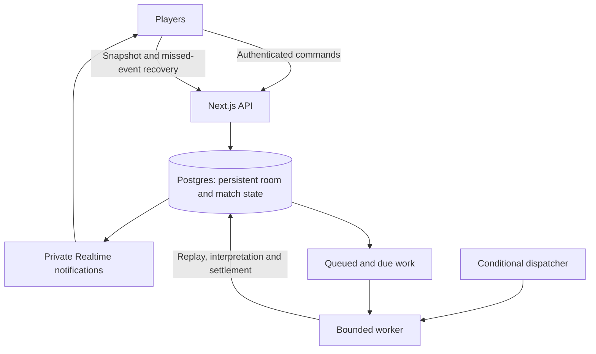

# Called It: free-only product plan

Updated 28 October 2026. This plan replaces the earlier paid-service options. The recurring services budget is **zero**. This release remains a solo cricket replay with scripted bot opponents; multiplayer is future work.

## Product direction

Build a small, dependable cricket game that friends can play together by sharing a room code. Preserve the existing replay, chat, receipts and Pundit Cards. Start with private groups of 2–8 players, with three concurrent rooms as an initial admission cap. These are conservative starting limits to validate, not a guarantee that a free tier can support arbitrary traffic.

Success means one person creates a room, two friends join from separate devices, and all three finish a match with the same server-scored receipts and ranking. They can refresh, disconnect and rejoin without losing their identity or points.

Do not require a payment method, paid plan, paid trial, purchased domain, SMS login, paid AI or live cricket subscription. When a quota is near its cap, limit new sessions and show a clear availability message. Do not upgrade automatically or promise unlimited availability.

## Available now

- A complete solo replay of India v South Africa's 2024 T20 World Cup final.
- Four starting points and playback controls.
- A built-in English/Hinglish reader, deterministic settlement and simulated boldness ratings.
- Three scripted bot opponents, receipts, a leaderboard and a final card.
- Recovery in the same browser tab.
- External AI explicitly disabled by default. Existing keys alone cannot enable requests.

Today, the browser owns its room, clock, calls and points. The backend only supports optional AI. Multiplayer requires shared persistence and server-owned scoring; a room-code field alone would not make this a shared game.

## Free service choices

| Need | Initial choice | Budget rule |
|---|---|---|
| Existing web UI/API | Vercel Hobby for an eligible personal, non-commercial project | Free provider subdomain; stay within the plan's terms and quotas |
| Identity | Supabase Free anonymous Auth | No SMS/email requirement; optional account linking later |
| Rooms, history and points | Supabase Free Postgres | Short retention, measured usage and manual backups |
| Shared updates | Private Supabase Realtime Broadcast | Small rooms, bounded payloads, capped concurrent sessions |
| Replay processing | Database-backed due work with one conditional dispatcher | No permanently running paid server or idle worker invocations |
| Prediction reading | Existing built-in rules | No external AI needed |
| Match data | Bundled historical replay, then attributed Cricsheet replays | No live-data subscription |
| Monitoring | Provider dashboards and structured logs | No paid observability dependency |
| Sharing | Browser share sheet or a user-initiated link | No messaging/SMS delivery service |

Vercel Hobby is restricted to personal, non-commercial use. Offering a free hobby app to friends must remain within those terms. If the project later becomes commercial, do not silently keep using an ineligible hosting plan. An alternative free path is a static frontend on Cloudflare Pages with server functions on Supabase; that requires moving the current Next.js API/runtime features out of the static build and validating the migration. It is not a drop-in change to the current app. [Vercel Hobby terms](https://vercel.com/docs/plans/hobby), [Cloudflare Pages](https://www.cloudflare.com/products/pages/).

Supabase Free currently includes 500 MB of database storage, 5 GB of egress, 50,000 monthly active users and 500,000 Edge Function invocations. Free projects may pause after one week of inactivity, and automatic database backups are not included. Treat this as a limited hobby/beta service with manual export and restoration procedures. Do not use synthetic activity to evade pausing. [Plan limits](https://supabase.com/pricing).

Realtime Free currently includes 200 peak connections and two million messages per month. Room caps should be much lower to leave space for reconnects, testing and multiple tabs. Count notifications delivered to all recipients, not just messages typed by users. [Realtime limits](https://supabase.com/docs/guides/realtime/pricing).

These are checked allowances on the document date, not promises that vendors will keep them unchanged. Recheck eligibility and limits before each release.

## The multiplayer experience

1. Home offers **Create room**, **Join with code** and **Play solo** once those features exist. Keep the current solo entry until then; no nonfunctional join-code controls.
2. A creator chooses a name, replay scenario and room name. Anonymous authentication gives them a stable user ID.
3. The server creates a lobby and collision-checked eight-character invitation code. The user can copy the URL or share it themselves.
4. Friends join, pick display names and appear in the lobby. The server enforces capacity and membership atomically.
5. The host starts a single replay clock. Everyone receives the same match state and chat.
6. Each message gets a server timestamp and match position. The server applies one interpretation and one rating for every observer.
7. Ball events settle claims and add unique points entries. The room leaderboard is shared.
8. Reconnect loads a snapshot and missing events. It does not restart the game or reset anyone else's score.
9. The room finishes after all pending messages and calls have reached a final state. Members receive personal cards and the same final ranking.

A guest can return with the same saved identity in the same browser. A name is not an identity, and another device cannot safely recover that identity merely by typing the same name. Account linking can solve this later. Supabase supports anonymous identities and linking, with abuse controls needed for signups. [Anonymous Auth](https://supabase.com/docs/guides/auth/auth-anonymous).

Bots are optional and visibly labeled in multiplayer rooms. Late entrants start at zero and can only predict future events; existing totals never change because someone joined. Hosts may lock joins, remove members and transfer ownership. Hosts cannot edit scores. Presence is advisory: a temporary disconnect is not a departure. An active replay continues when the host disconnects; all-idle rooms pause at a server-defined point to save free resources, with no new calls admitted until a consistent resume.

## Architecture

Retain the existing pure TypeScript engine. Replace the browser-specific room coordinator with an authoritative server service. `Who = you | friend ID` becomes a real user ID. Remove direct access to future deliveries and results from multiplayer clients; the browser receives only the permitted replay position, public scorecard and room history.

Private Broadcast is the recommended Supabase route for scalable database updates. It needs room-specific access policies. Authentication alone must not authorize every room. Durable database events remain the recovery path even if a notification is missed. [Broadcast guidance](https://supabase.com/docs/guides/realtime/subscribing-to-database-changes), [channel authorization](https://supabase.com/docs/guides/realtime/authorization).

Minimum records: `profiles`, `rooms`, `room_members`, `replay_sessions`, `match_events`, `match_snapshots`, `messages`, `calls`, `score_entries`, `room_events`, and queued jobs. Use UUIDs, room/member foreign keys, per-room event sequences and indexes for active calls, recent history and due work.

Commands: create room; join by code; get snapshot/history; send message; choose clarification; start/pause/resume replay; transfer host; remove member; leave. Every command checks the authenticated user's active membership. Browser writes to scores, match events and jobs are denied by database policies.

## Replay clock and jobs without a paid worker

Use persisted server start time, pause intervals and match sequence. Browser timers animate the UI; they cannot decide which delivery is current or whether a prediction is late.

For the first free beta, use one global dispatcher to check for due active replays and visible jobs. Dispatch only when work exists. Supabase Cron can run at second-level intervals, and Supabase Queues can persist retryable work. It must not invoke a serverless function every second all month while no rooms are active: that would waste the free invocation allowance. [Cron](https://supabase.com/docs/guides/cron), [Queues](https://supabase.com/docs/guides/queues).

Each worker leases a bounded batch, commits its changes and exits. Prefer the existing Node engine behind an authenticated endpoint while Vercel Hobby eligibility holds. Benchmark shared engine packaging on Supabase Edge Functions if migrating hosting. Their current CPU allowance is two seconds per request; do not assume many full-match simulations fit in one invocation. [Runtime limits](https://supabase.com/docs/guides/functions/limits).

Database uniqueness and transactions enforce one business effect despite queue retries. Do not claim a queue alone makes points exactly-once. At prediction admission, catch up an overdue replay tick or reject precision calls until state is current. A delayed worker cannot leave an old outcome available for scoring.

## Server-owned predictions and points

1. Verify identity, membership, room state and persistent rate limits.
2. In one short transaction, persist the message, client request ID, server receipt time and authoritative match snapshot. Enqueue any processing work atomically.
3. Parse with the built-in reader. Ambiguous text produces concrete options instead of an invented deadline.
4. Simulate the accepted claim from the captured snapshot, with a deterministic seed and a fixed model/rules version.
5. Serialize one player's pending messages in receipt order for slot admission. Enforce three open calls, duplicate keys and overlapping-threshold rules transactionally.
6. Settle against ordered match events. Update status and insert a uniquely identified ledger entry together.
7. Notify clients only about committed changes. Retry failures safely.

Uniqueness keys include `(room_id, user_id, client_request_id)` and each call's settlement revision. A canonical duplicate key includes the actual interval: “next ball” on one delivery is different from “next ball” after that delivery has finished.

A clarification is locked when the player chooses it, not backdated to the earlier vague message. Retractions have a server deadline before the relevant outcome is revealed. Offline predictions remain drafts until the server receives them. Neither client clocks nor edited local storage can change accepted times or points. Cards are generated from the server ledger.

The current reward tiers have sharp boundaries, and three similar thresholds can describe almost the same outcome. Before competitive rankings, test a smooth bounded reward rule and one active claim per player/metric/target interval. Keep each room's scoring version fixed. Historical replay scores are social challenges with known outcomes, not evidence of live prediction skill.

## Recovery, privacy and operating limits

- Subscribe and buffer, load a consistent room/match snapshot with cursors, then apply newer events. Fetch gaps after reconnect and reconcile periodically.
- Invites use cryptographic randomness, collision checks, expiry/rotation and guess-rate limits. Display names are never authentication credentials.
- Enforce row-level room access and server checks. Keep secret credentials out of clients. Removal rotates the private channel epoch so cached subscription authorization cannot leak future messages.
- Cache probability estimates by canonical claim, snapshot and model version. All players receive the same stored estimate; no silent cheaper rating for a particular player.
- Begin with text-only chat, no uploads and a 200-character limit. Pagination loads 50 recent messages rather than full room history.
- Proposed beta limits: 8 members per room, 3 concurrent rooms, a maximum 30-minute timed replay session, and 20 new accepted scoring calls per member per session. Longer replays can remain solo initially.
- Expire abandoned lobbies after 24 hours. Keep completed room chat for 7 days and compact result summaries for 30 days, then delete according to the published retention policy. Preserve records needed by active calls and open disputes until resolved.
- Make a manual encrypted export before migrations and regular exports while the beta has activity. Keep exports off the public repository and test restoration locally.
- Check provider dashboards and application counters. At a conservative 70–80% of a monthly free allowance, stop accepting new multiplayer rooms and keep solo mode available. Monitor actual usage; app counters cannot control unrelated project traffic or provider changes.
- Keep plans on Free/Hobby with no paid trial or add-on. If a service pauses or becomes unavailable, say so and offer solo play. Do not promise a production SLA at zero cost.

A first planning envelope is 50 short room sessions per month. At 30 minutes and a five-second tick, this is about 18,000 tick opportunities before chat, calls and retries. At 8 recipients, 250 ball updates produce about 2,000 ball deliveries per full replay before other notifications. These are rough sizing calculations, not bills or capacity guarantees. Measure real jobs, payloads, reconnects, presence and CPU, then reduce admission limits if needed.

## Match content without a data subscription

Keep the bundled replay first. Add a small curated set of historical matches after refactoring the hardcoded roster into match-specific squads, player IDs, aliases and team names. Cricsheet provides historical downloads; JSON data uses the Open Data Commons Attribution License. Preserve attribution and transformed-data notices in the app and repository. [Downloads](https://cricsheet.org/downloads/), [licensing](https://cricsheet.org/licensing/).

Do not make automated professional live feeds part of the zero-budget promise. A future free community mode could let an authorized host enter deliveries for their own local match, with visible “manually scored” labeling, corrections and an audit trail. That is a separate feature requiring its own testing; it would not claim to be an official live feed.

Replays and manual games need explicit handling of revised/removed events, abandoned matches and unsupported rules. Corrections add compensating point entries and revised receipts. Unsupported outcomes are void, not ordinary misses. Start with standard T20 rules; add reduced overs, revised targets and Super Overs only with tested policies.

## Delivery plan

| Phase | Work | Acceptance gate | Estimate |
|---|---|---|---|
| 0 — Current product | Product identity, solo replay, built-in reader by default, documentation | A first-time visitor understands what is available and can finish a game without keys | This release |
| 1 — Room foundation | Local Supabase schema, guest identity, membership rules, create/join lobby, invite codes | Three independent browsers join one private lobby; outsiders cannot read it | 4–6 development days |
| 2 — Shared replay | Server clock, authoritative chat/calls, ledger, private events and due-job worker | Three players finish with identical scores even after retries and host disconnect | 5–8 days |
| 3 — Free private beta | Reconnect, removal, quotas, retention, export/restore and onboarding | Five friend groups complete at least two sessions; no duplicate points or cross-room access | 4–6 days |
| 4 — Reusable app | Match-specific rosters, more replay scenarios, personal history, account linking | Another replay works without changing the core engine; users return with their identity | 1–2 weeks |
| 5 — Platform polish | Accessible install experience, saved match browsing, permitted hosting migration if needed | Mobile browser checks pass; free deployment stays within its actual terms and limits | After beta evidence |

Estimates assume one experienced full-time developer reusing this interface. Around 3–5 focused weeks is a reasonable starting estimate for the first usable multiplayer beta, excluding account setup delays. Future phases depend on observed limits and user feedback. No paid live-feed phase is required.

Build against local development services first. Cloud account creation, permissions and terms require the owner's participation. Do not create paid accounts or publish a deployment merely because they appear in this plan.

## Tests before people depend on it

- Different devices see identical sender identities, match position, calls and final ranking.
- Two joins racing for the last slot admit only one; duplicate creation cannot create overlapping codes.
- Two predictions racing for the last open slot cannot both pass.
- Repeated requests and a worker crash after commit produce one message/call/points effect.
- Slow parsing uses the original snapshot. Clarifications cannot be accepted after an outcome and backdated.
- Refresh, dropped realtime messages and a five-minute disconnect recover the correct state.
- Host disconnect and ownership transfer do not reset the replay or ledger.
- Removed members lose future room access; changing client time/context/points has no effect.
- An exhausted quota, paused database or worker outage leaves a clear recovery/solo route.
- A replay correction reverses the original effect exactly once, with a visible explanation.
- A new, human-labeled English/Hinglish set measures correctness independently of the 46 existing regression phrases.

Track time to first friend joining, groups reaching three members, session completion, disputed interpretations and groups returning. The first success criterion is a small group enjoying a reliable second session—not a large signup count.
